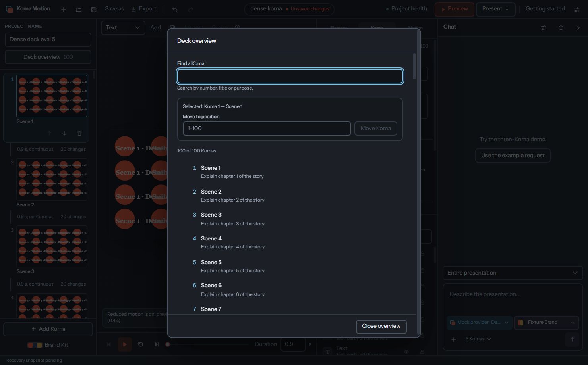
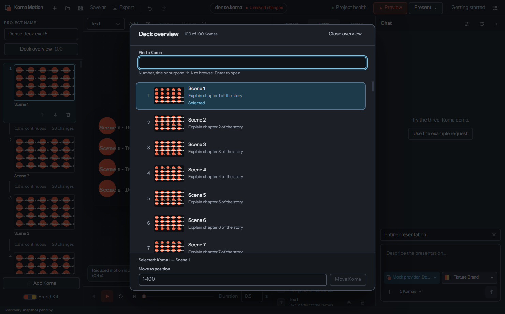
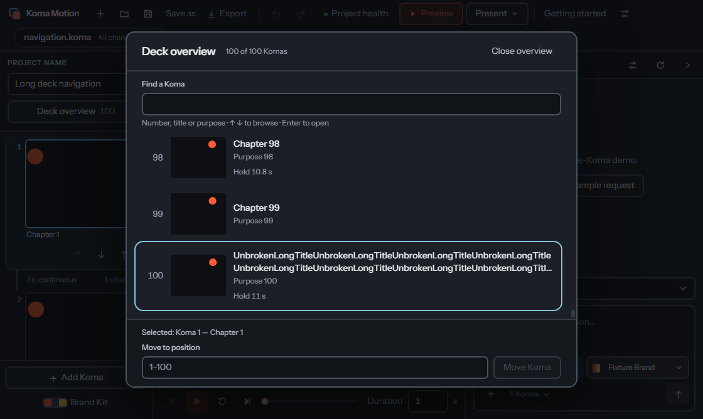

# Deck workspace verification

Native Electron captures from the dedicated Windows lab on 29 October 2026.
Both performance runs used 100 Komas with 20 shapes and 20 text elements each,
a 1480 × 920 content area and reduced motion. The baseline is
`f4cca6fe52e65e047922f859f71d11bf9f545da8` with only the new eval added;
the candidate is clean application revision
`f9edc728b98576f6d4c934b450a27157c32f2d63`.

| Metric                      | Before | After |
| --------------------------- | -----: | ----: |
| Rendered strip thumbnails   |    100 |     5 |
| DOM nodes in the Koma strip | 17,604 | 2,314 |

[Raw measurements](performance.json) include open time and six renderer task-time
samples for project renames. These are local diagnostics from one before/after
pair; the repeatable regression gates enforce at most 12 rendered strip stages
and 4,000 strip DOM nodes, with all 100 navigation buttons retained. The baseline
fails that gate and the candidate passes. Image-heavy decks and macOS were not
measured.

The candidate passed formatting, lint, type checking, 1,180 unit tests
(7 skipped), 48 script tests, the build and all 43 selected native scenarios.
These cover generation, direct editing, grouping, Inspector, preview identity,
motion warnings, file handling and long-deck navigation. Native Open/Save dialogs
are stubbed; generation uses mock providers.

Additional drag stress remains intermittent on both baseline and candidate.
The baseline reproduced capture loss once in six runs. Native and renderer
traces show capture loss with no mouse button pressed at the desktop cursor's
position during a synthetic drag, while the application stays focused. No
assertion was weakened, and experimental input-driver changes were discarded.
See [issue #108](https://github.com/Dytschgo/koma-motion/issues/108). The full
43-scenario pass must not be read as a claim that this stress issue is fixed.

## Before

## After

## Short window and 4:3 canvas

The 1120 × 668 check includes a long unbroken title, keyboard browsing to the
last Koma, selecting and reopening it, Tab access to the move form, an empty
search result and focus return. Titles clamp while their full text remains in
accessible names and title tooltips.

